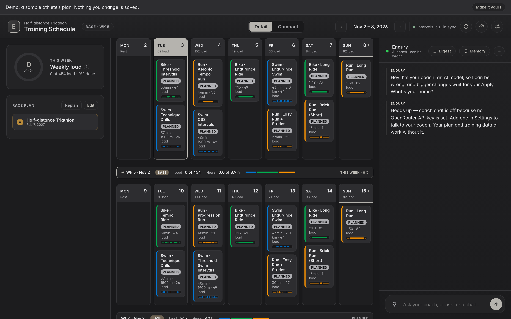
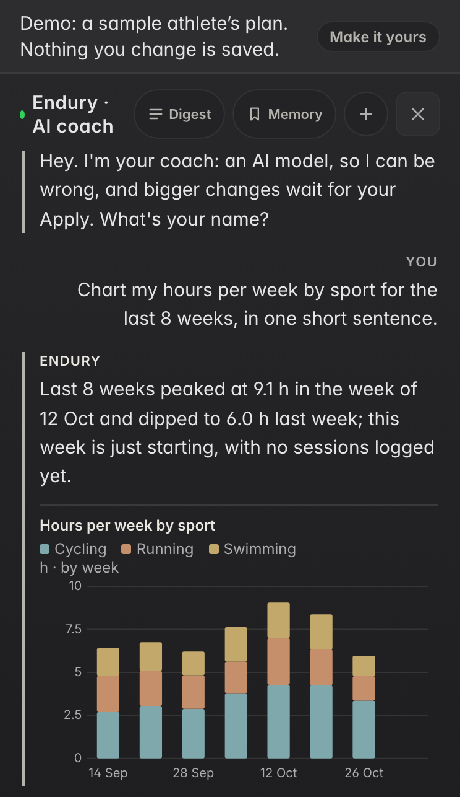
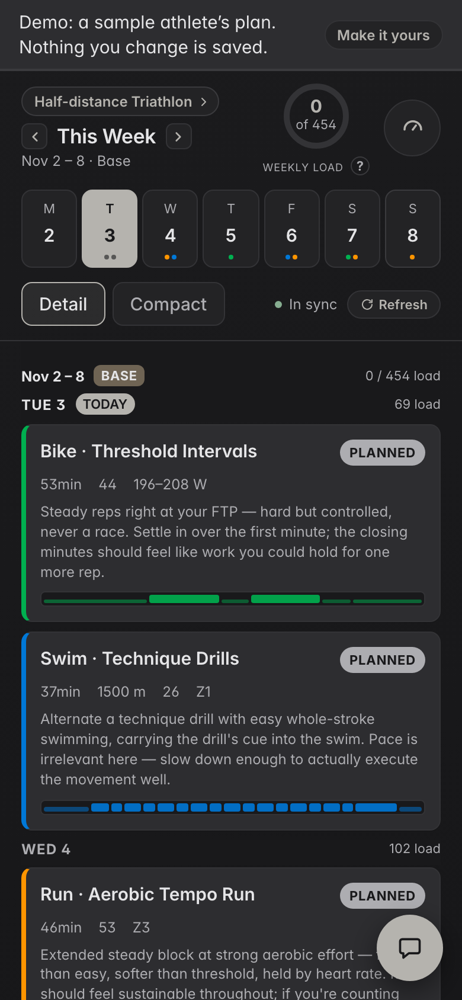
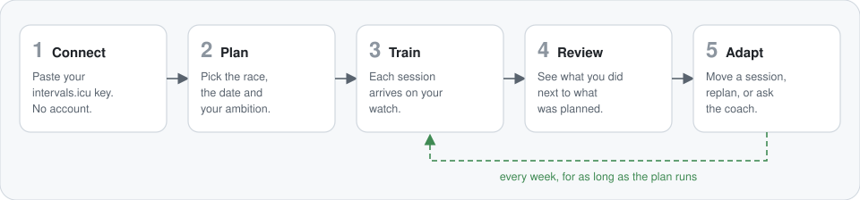
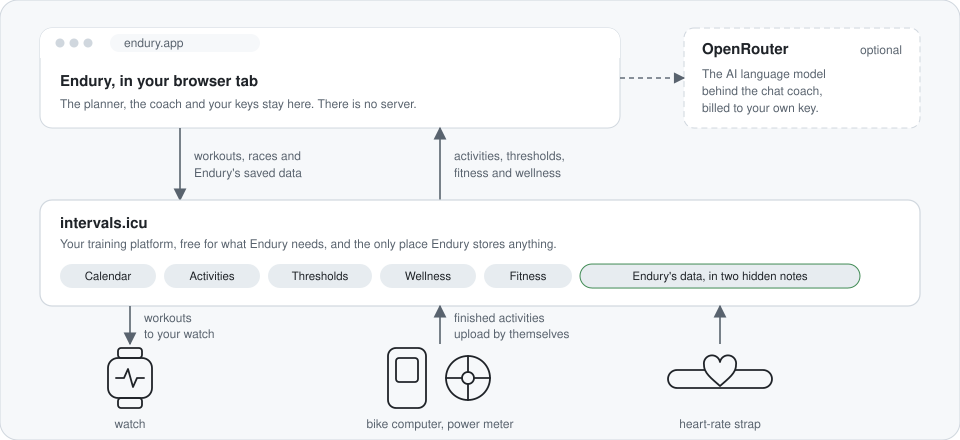
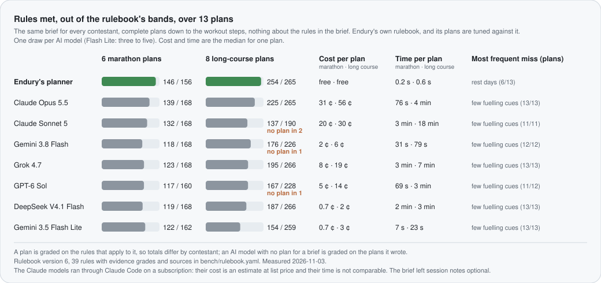

<!-- SPDX-License-Identifier: AGPL-3.0-or-later -->
<p align="center">
  <a href="https://endury.app"></a>
</p>

<h1 align="center">Endury</h1>

<p align="center">
  <strong>A free, open-source endurance coach that runs in your browser.</strong><br>
  Name a race. Endury builds the preparation from the training you already do,<br>
  sends your sessions to your watch, and replans when life intervenes.
</p>

<p align="center">
  <a href="https://endury.app"><strong>Try it</strong></a> &nbsp;·&nbsp;
  <a href="VISION.md">Why Endury</a> &nbsp;·&nbsp;
  <a href="docs/privacy.md">Privacy</a> &nbsp;·&nbsp;
  <a href="CONTRIBUTING.md">Contributing</a> &nbsp;·&nbsp;
  <a href="SECURITY.md">Security</a> &nbsp;·&nbsp;
  <a href="CHANGELOG.md">Changelog</a>
</p>

<p align="center">
  
  
  
</p>

<a href="https://endury.app"></a>

There is no subscription and no account, and no Endury server holds your
data. Your training stays on your
[intervals.icu](https://intervals.icu) account, and the coaching
logic is open to read, change and host. The optional chat coach runs on
an AI language model through your own OpenRouter account. You pay
OpenRouter directly, from about $0.003 a message with the default AI model;
a full debrief or analysis costs more.

## What it does

- **Builds a plan for your race.** Six plans are on offer for now, each
  finished before the next: the trail 20K and trail maintenance at the basic
  level, and the half marathon, half-distance and full-distance triathlons and
  triathlon maintenance at the moderate level. Tune-up races of any type fit
  in. Seven more race goals, from 5K to trail 100K and from sprint to
  standard distance, wait in the repository.
- **Starts from your real training.** Threshold pace and power, fitness
  and recent volume are read from intervals.icu. With little history
  there, a short questionnaire asks about your recent weeks.
- **Sends your sessions to your watch.** Where intervals.icu supports the
  device, each goes out as a structured workout with targets from your
  thresholds, numbered in your own intervals.icu zones.
- **Debriefs each session.** How hard every minute was, time in each zone
  and rep-by-rep splits, next to what was planned.
- **Adapts.** Move a session, replan from Monday, pause, lighten a week,
  add a race. Endury writes only its own events and leaves the rest of
  your calendar alone.
- **Talks, if you want it to.** The chat coach reads your training and
  your plan and refines the weeks ahead through the planner. Larger changes
  wait for your tap on **Apply**. Ask how you paced a race's climbs, and it
  draws the chart under its reply.

<table>
  <tr>
    <td width="50%" valign="top"></td>
    <td width="50%" valign="top"></td>
  </tr>
  <tr>
    <td valign="top"><sub>The coach, asked to chart the sample athlete's last eight weeks by sport.</sub></td>
    <td valign="top"><sub>On a phone: this week's agenda, with today's sessions and their workout outlines.</sub></td>
  </tr>
</table>

The plan itself comes from a planner, not from the AI language model:
coaching templates sized by a solver, the same plan for the same inputs,
in about a second and at no cost. Why, and how it compares with AI models,
coaching apps, plan templates and a human coach, is in [VISION.md](VISION.md).

## How it fits together

Week to week, Endury is a loop.

<picture>
  <source media="(prefers-color-scheme: dark)" srcset="docs/readme/the_loop_dark.svg">
  
</picture>

Your watch uploads to intervals.icu. Endury reads your thresholds, fitness
and history there, pushes each planned session back, and keeps its own data
in hidden notes on your account, so every device sees the same plan.

<picture>
  <source media="(prefers-color-scheme: dark)" srcset="docs/readme/how_it_fits_dark.svg">
  
</picture>

## Is it any good?

Endury is based on a benchmark we developed for endurance training: 55
coaching rules, each with its band, its evidence and its sources
([bench/rulebook.yaml](bench/rulebook.yaml)). It is open to read and to
argue with, but it is our own yardstick, not an independent standard.
Endury's plans are graded against it on every change, so of course they
score well.

For a second reading we asked seven AI language models for the same
thirteen plans and graded them on the same rules. By list price, the more an
AI model cost, the closer it tended to come; the dearest we asked came closest.
Few samples, so a first reading and not a ranking.

<picture>
  <source media="(prefers-color-scheme: dark)" srcset="docs/readme/benchmark_dark.svg">
  
</picture>

The briefs, every answer and every grading are in [bench/](bench/README.md).
What checks a plan, and what a human has reviewed, is in
[docs/quality](docs/quality/README.md). Each plan type carries a maturity
label, Experimental, Alpha or Beta, explained in
[docs/plan_maturity.md](docs/plan_maturity.md).

## Get started

Open [endury.app](https://endury.app). The first visit offers a demo with
a sample athlete, or connects your
intervals.icu in three short steps. Settings changes any of it later.

| Setting | Needed | Where to get it |
| --- | --- | --- |
| intervals.icu API key | Yes | intervals.icu → Settings → Developer Settings |
| OpenRouter API key | Only for chat | **Connect OpenRouter** signs you in and fills it in, or paste one from [openrouter.ai/keys](https://openrouter.ai/keys). Give it a spend limit. |
| AI model for the chat | No | Any OpenRouter model id. The default is `anthropic/claude-haiku-5.5`. |

- In intervals.icu, enable **Upload planned workouts** for your watch
  platform, so the sessions Endury pushes reach your device.
- The first visit downloads the Python engine once, about 34 MB. Later
  visits load it from the cache in seconds.
- On a phone, Add to Home Screen installs it as an app.

## Privacy

The app sends nothing you do in it to its authors. Your keys stay in this
browser, each sent only to its own service, and your training lives on your
intervals.icu account. When you chat, your message and the coach's
working context, health data included, go to OpenRouter (USA) and the company
that runs the AI model; Endury asks for services listed as keeping no data. What is stored where, and how to remove
all of it: [docs/privacy.md](docs/privacy.md).

## Run or host your own copy

You need Python 3.11 or newer, [Poetry](https://python-poetry.org/) and
git. If `make install` picks an older interpreter, run
`poetry env use 3.11` first.

```bash
git clone https://github.com/endury/endury.git && cd endury
make install        # Python dependencies for the build, tests and devtools
make site           # build the static site into site/
make serve          # serve it at http://localhost:8080
```

`site/` is a plain static site with relative paths, so any static host
serves it, also under a sub-path. It serves its own copy of the Python
runtime, so visitors fetch nothing from a third party. Before you publish:

- **Put your name on it.** `web/impressum.html` and `web/privacy.html`
  are the legal notice and the privacy policy. Point the source links at your
  repository: `SOURCE_URL` in `web/components/settings_panel.js` and the links
  in those two pages. If you run a changed copy, the AGPL has you offer your
  changed source and say it was changed. Put your details in `~/.config/endury/legal.json`
  with the keys `full_name`, `street`, `city` and `email`. `make site`
  writes them into the built pages, so they stay out of your repository,
  and `make deploy` stops if the pages are still blank.
- **Send the security headers.** The Content Security Policy in `web/_headers`
  is needed on every host, not just Cloudflare: it keeps the page to its own
  origin and completes the analysis sandbox's seal. Other hosts set it their own way.
- **Give it an origin of its own, over HTTPS.** Browsers share
  `localStorage` across an origin, so any other page on the same host
  could read the keys Endury stores. `localhost` is fine for development.
- **On Cloudflare**, how endury.app is hosted: `make deploy` uploads
  `site/` per `wrangler.jsonc`; change its `name` and custom-domain
  `pattern` to your own. `web/_headers` sets the security headers there.

Development needs neither a browser nor keys: the planner, the coach and
the store run natively under pytest against in-memory fakes. Start at
[CONTRIBUTING.md](CONTRIBUTING.md).

## How it is made

I like endurance sport, and I wanted to see how far coding agents, AI
language models that write and test software, could take a hobby project.
Further than I expected: it now has a solver, a rulebook and strong
opinions about tapers, and I train with it myself.

The main algorithm is conceptually adopted from model predictive control,
my research background: a model of fitness and fatigue, a plan optimised
over the whole preparation, and a fresh solve when life gets in the way.

The agents write the code, the tests, the menus and these docs. I chose the
approach, decide what to build and what a good plan looks like, review the plans
on offer session by session and change what is wrong, argue with them about long
runs, and answer for what ships. Every change still has to pass the tests
and the plan scorecard, because nobody here gets to trust their own first
draft, me included. So take it for what it is: a hobby project that takes
its plans seriously. [CONTRIBUTING.md](CONTRIBUTING.md) says how that
works, and how to contribute with or without an agent.

## License

Copyright (C) 2026 Kim Wabersich and Endury contributors. Endury is free
software under the [AGPL-3.0-or-later](LICENSE), with no warranty. The Inter font,
the Code of Conduct and the saved AI answers carry their own terms, and the licence
does not cover the name and icon as a mark: see [NOTICE](NOTICE) and
[THIRD_PARTY_NOTICES.md](THIRD_PARTY_NOTICES.md).

Product, service and event names belong to their owners. They appear only to say
what Endury works with or can prepare for; Endury is independent of all of them.
