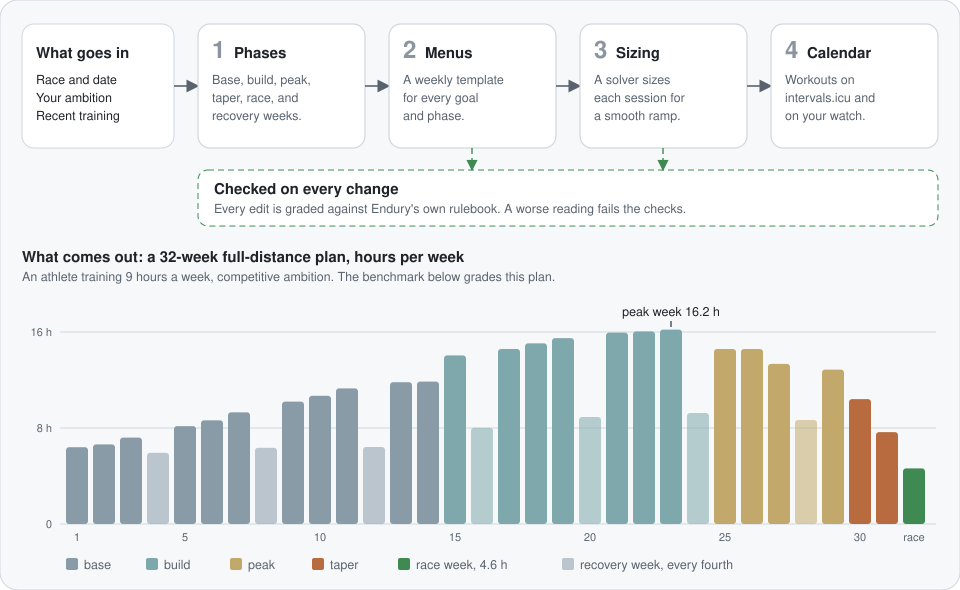

<!-- SPDX-License-Identifier: AGPL-3.0-or-later -->
# What Endury is for

Endury is a free endurance coach that builds the whole preparation for a
race from the training you already do, puts every session on your watch
through [intervals.icu](https://intervals.icu), and replans when life
intervenes. This page says why it is built the way it is, what it will
and will not do, and how it compares. The [README](README.md) says how to
use it.

## Why another AI coach?

An AI language model, the technology behind ChatGPT, Claude and Gemini,
writes a passable marathon plan. Ask it for a whole full-distance triathlon preparation,
three hundred sessions over eight months, and most drift: peak weeks
beyond any sensible range, VO2max intervals in the base phase, a taper
that deletes sessions instead of shortening them. In
[our own benchmark](bench/README.md) the planner met more of its house
rulebook than any of the seven AI models asked for the same plans, which
is the least you would expect, and the most expensive AI model came
closest. Four of them returned no complete plan at least once, and five draws
of one brief gave five different plans. A plan from an AI model costs money and
minutes, and a preparation is replanned many times: a cold, a work trip,
a missed week, a new race. AI language models are good at the next
paragraph and poor at keeping three hundred things consistent.

Endury therefore separates the two roles. **The plan comes from a
planner, not an AI model.** Coaching templates are sized by a solver.
The same inputs give the same plan. Every change is graded against
Endury's own coaching rulebook, and the plan is built in your tab in about a
second at no cost, so a replan is never put off. **The AI model is the
coach you talk to.** It reads your data, explains and proposes. It can
be wrong, so every change goes through the planner and the larger ones
wait for your tap.

## How the planner works

<picture>
  <source media="(prefers-color-scheme: dark)" srcset="docs/readme/how_the_planner_works_dark.svg">
  
</picture>

1. **Phases.** A week-by-week skeleton from your race date and ambition:
   base, build, peak, taper and race, with a recovery week every third
   or fourth week.
2. **Session menus.** For every goal, phase and week type, a weekly
   template says which session falls on which day, how long it is, and
   why.
3. **Sizing.** A solver sizes every session within its bounds so that
   load ramps smoothly and you arrive fresh, using the fitness-fatigue
   model behind your performance chart.
4. **Calendar.** Menu days become dates. Every session goes to
   intervals.icu as a structured workout with targets from your
   thresholds.

The menus are plain YAML, written for athletes and coaches:

```yaml
- name: mar_base_sun_long_run
  day: sun
  activity: run_long
  minutes: {scaled: [90, 135]}
  why: >-
    The long run is the spine of marathon training — it teaches your legs,
    and your fuelling, to keep working long after the fun stops. In these
    early weeks it grows steadily and stays easy: durability has to come
    before pace.
```

One rulebook grades every plan: [bench/rulebook.yaml](bench/rulebook.yaml)
holds the rules of periodisation, load, tapering, intensity and session
design, each with its band, its evidence grade and its sources. The scorecard builds every
plan on offer at several plan lengths and training volumes and reads all
of them; its readings are committed, and a change that moves a plan
further from a band fails the build. Each plan type also carries a
maturity label. Experimental means built from the research. Alpha means
its sessions were reviewed one by one, the scorecard grades it and the
rulebook holds a band of that goal's own. Beta means athletes have
trained with it. The labels, with their evidence, are in
[docs/plan_maturity.md](docs/plan_maturity.md).

## Principles

- **The plan is never written by an AI model.** Coaching templates and a
  solver build it; the same inputs give the same plan; every change to
  the templates or the solver is graded against Endury's own rulebook
  before it ships.
- **The coach proposes, you apply.** The chat coach reads your data,
  explains and suggests. Small bookings happen at once; anything that
  rewrites your plan is previewed and waits for your tap on **Apply**.
- **The current week is yours.** Replanning starts next Monday. What is
  already on this week's calendar changes only when you ask for that
  week.
- **No account, and no copy of your data on an Endury server.** Endury runs
  in your browser tab. intervals.icu is where your training lives and where
  Endury keeps its own data, so every device sees the same plan and the app
  sends nothing to Endury's authors.
- **Bring your own keys.** The intervals.icu key is required; the
  OpenRouter key is optional and billed to you at the AI model's price.
  Each key is sent only to its own service.
- **Runs wherever a browser runs.** Phone, tablet, laptop, any operating
  system, installable on a home screen. The first visit downloads the
  engine once; after that it loads from the cache.
- **The coaching logic is open.** Session menus and the bands they are
  graded against are YAML in this repository, written to be read and
  changed by athletes and coaches, not only by programmers.
- **One coach, one voice.** There is a single AI model behind the chat
  and a single persona; the athlete picks the AI model, not a tier.

## Scope

- **Race goals:** 5K, 10K, half marathon, marathon; trail 20K, 50K and
  100K; sprint, standard, half and full distance triathlon,
  plus a raceless maintenance block per sport. Six plans are on offer for
  now: the trail 20K and trail maintenance at the basic level, and the half
  marathon, the half-distance and full-distance triathlons and triathlon
  maintenance at the moderate level. The
  others keep their menus and return one at a time, each after its
  sessions have been reviewed one by one. A plan
  type is Experimental until then, and asks the athlete to confirm before
  it is built; it becomes Alpha once its sessions are reviewed, and
  Beta once athletes have trained with it; none is yet ([plan
  maturity](docs/plan_maturity.md)).
- **Inputs:** a race date, an ambition level, optional tune-up races and
  an optional weekly-hours cap; thresholds, fitness and recent volume
  read live from intervals.icu, or a short self-assessment when there is
  little history.
- **Outputs:** structured workouts on your intervals.icu calendar with
  targets relative to your thresholds, a debrief of every completed
  session against its plan, and the verbs to move, swap, lighten, pause,
  replan and add a race.

## Not planned

- **Route maps, meal plans and strength training.** Other tools do these
  well. Sessions and briefs carry general fuelling cues, no diet advice.
- **An Endury server or account.** Anything that would need one is out.
- **Other training platforms.** intervals.icu is the one platform Endury
  reads from and writes to; running with no server depends on it being
  the store as well as the data source.
- **Plans written by an AI language model.** The AI model may explain
  and propose; the planner decides.

## Where it stands

| | Endury | An AI language model as coach | AI coaching apps | Plan templates | A human coach |
| --- | --- | --- | --- | --- | --- |
| Price | Free, open source (AGPL); only the optional chat is billed, at the AI model's price | A chat subscription or API fees | Typically a monthly subscription | One-off, some free | A monthly fee |
| Who builds the plan | Coaching templates plus an optimisation solver; same inputs, same plan | The AI model, in one shot; different each time | A closed AI model or algorithm | An author, once, for everyone | A person, for you |
| Checked against what | Its own rulebook, open to read; the plans on offer are graded against it on every change | Rarely published | Rarely published | Usually the author's experience | The coach's experience |
| Goals | Six plans on offer for now; seven more race goals and a running maintenance block keep their menus and return one at a time | Anything, unverified | The vendor's list | One race, one length | Anything |
| Starts from your real training | Thresholds, fitness and recent volume, live from intervals.icu | Usually what you paste in | Usually through their own sync | Rarely | Usually |
| Workouts on your watch | On supported devices, structured, targets relative to your thresholds | Usually by hand | Usually | Depends on the platform | Depends |
| Knows what you actually did | Every session pairs with the recorded activity | Usually not | Usually | Rarely | Usually, through a shared platform |
| Adapts when life happens | Replan, pause, lighten, swap or move, free and in about a second; big changes previewed, applied by you | Re-prompt by hand: a paid call, minutes, a different plan each time | Usually | Rarely | Yes |
| Where your data lives | Your intervals.icu account; keys in your browser; no Endury account | The chat provider | The vendor's cloud | n/a | With the coach |
| Change the coaching logic | Yes: menus and bands are YAML in this repository | No | No | No | By request |
| Not covered | Route maps, meal plans, strength | | | | |
