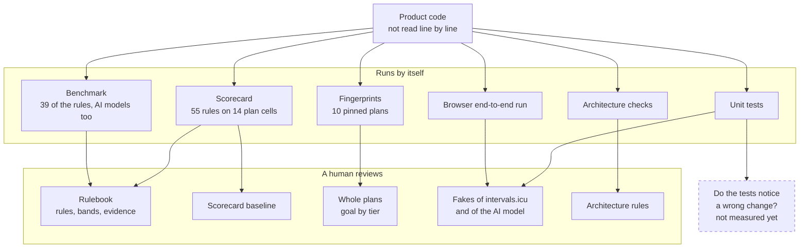

# Plan quality: what is checked, and what a human reviews

Endury's code is written by coding agents and is too large to read line by
line. This page is the one place that says what checks a plan, what each
check rests on, and which of those foundations a human has reviewed.

## The map

Each arrow reads "is only as good as". The checks run by themselves; the
boxes they point to are small, and they are what a human reads.

## What a human reviews

A row counts as reviewed for the content at the commit named, not after it.

| What | Where | What rests on it | Last reviewed |
| --- | --- | --- | --- |
| The rulebook: every rule, its band and its evidence | [`bench/rulebook.yaml`](../../bench/rulebook.yaml), shown as [rules.md](rules.md) | The scorecard and the benchmark | Not recorded yet |
| The scorecard baseline: the readings no change may worsen | [`planner_matrix.json`](../../devtools/quality/baselines/planner_matrix.json) | The scorecard gate | Applied by the maintainer on 2026-10-04, with the rulebook merge |
| Whole plans, goal by tier | Rendered with `make run-devtool TOOL=planner_sweep_site` | The fingerprints, which only say that a plan did not change | Logged per goal and tier under [Menu reviews](../plan_maturity.md#menu-reviews) |
| The fakes of intervals.icu and of the AI model | `tests/doubles.py`, `endury/intervals/fake.py`, `devtools/frontend/fakes.py` | The unit tests and the browser end-to-end run | Not recorded yet |
| The architecture rules | `devtools/core/check_architecture.py`, the invariants in [AGENTS.md](../../AGENTS.md) | `make lint` | Not recorded yet |

## What runs by itself

| Check | What it catches | Command |
| --- | --- | --- |
| Unit tests | Code that does not do what its author meant; the planner is held at 100 % line coverage | `make test` |
| Fingerprints and menu canon | A change that alters a plan on offer (`--all`: any plan) or a menu without meaning to | `make run-devtool TOOL=planner_fingerprints ARGS='--rev main'`, then `TOOL=planner_menu_canon` |
| Scorecard | A change that moves a plan on offer further from a rule's band | `make test-scorecards` |
| Card honesty grid | A workout card of a plan on offer that is not the session the plan sized, a swim that misses its menu metres at CSS 1:40, 2:00 or 2:30 | `make test-scorecards` |
| Benchmark | Not a gate: how Endury's plans and AI language models' plans read on the same rules | [bench/README.md](../../bench/README.md) |
| Architecture checks | A broken boundary: the planner importing the wrong layer, time read without the clock, I/O inside a database block | `make lint` |
| Browser end-to-end run | A main flow of the app that breaks against the local fakes | `make run-devtool TOOL=e2e_lifecycle` |

## The rules

[rules.md](rules.md) lists every rule by race goal: what it measures, its
evidence, whether it is also asked of AI language models, and its bands. It
is generated from the rulebook by `make docs`, which `make lint` runs, and
`tests/devtools/test_rules_page.py` fails when the committed page is stale.

## What no check reads

- **The plans that are not on offer.** A menu names the tiers it offers
  (`offered:`); the scorecard, the card honesty grid and the fingerprints
  read those plans and no others. The unit tests still build every plan.
  A plan that returns is read afresh
  ([plan maturity](../plan_maturity.md#plans-on-offer)).
- **Two race goals.** The 5K and the trail 100K have menus, and the
  scorecard has no plan lengths to grade them at yet.
- **Most goals in the benchmark.** It asks AI language models for marathon,
  half-Ironman and Ironman plans only.
- **The coach's live replies.** The tests run the coach against a fake AI
  model.
- **A real intervals.icu calendar.** Writes and deletes are tested against a
  fake.
- **The tests themselves.** Nothing measures yet whether they would notice
  a wrong change to the code.

## Reviewing a change

The checklist in the
[pull request template](../../.github/PULL_REQUEST_TEMPLATE.md) is the
procedure for a menu or a band change; the validation ladder in
[CONTRIBUTING.md](../../CONTRIBUTING.md) has the commands.
