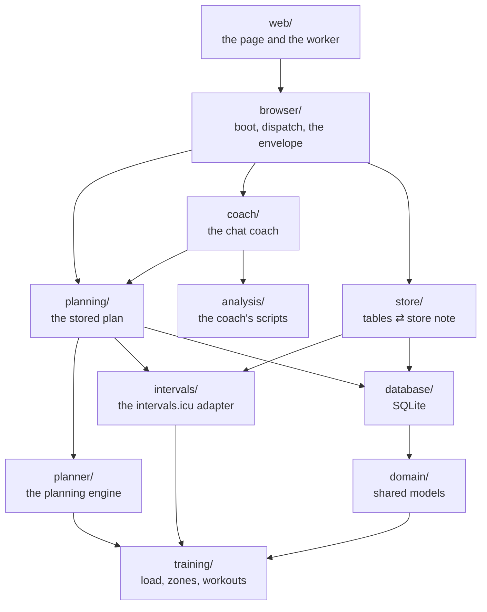

# endury

The application package. Each subpackage has a README that says what it
is for and where to start reading; this is the index. The page calls the
worker, the worker calls `browser/`, and everything below is plain
Python that runs the same under pytest.

The main dependencies; `common/` and `wiring/` serve every package.

| Package | What it does |
| --- | --- |
| `planner/` | The planning engine: phases, session menus, sizing, calendar days, the activity library. The only thing that makes a plan. |
| `planning/` | The stored plan: generate, commit, push, replan and edit it; the calendar and debrief views. |
| `coach/` | The chat coach: the turn loop, the tools, Apply cards, the prompt, the memory document. |
| `analysis/` | The library the coach's analysis scripts call, their runner and their charts. |
| `browser/` | The worker's entry point: boot, dispatch, one method per `web/data/api.js` export. |
| `store/` | The durable tables, to and from the hidden intervals.icu note. |
| `intervals/` | The intervals.icu adapter: client, models, workout DSL, calendar push, fitness. |
| `database/` | SQLite: the schema, its migrations, the repositories. |
| `domain/` | Shared models: athlete, memory, chat history, races, zones. |
| `training/` | The training-science kernel: load math, zone bands, the structured-workout schema. |
| `common/` | The injectable clock, the exceptions, the memory-document conventions. |
| `wiring/` | `CoachConfig` and the repository container. |
